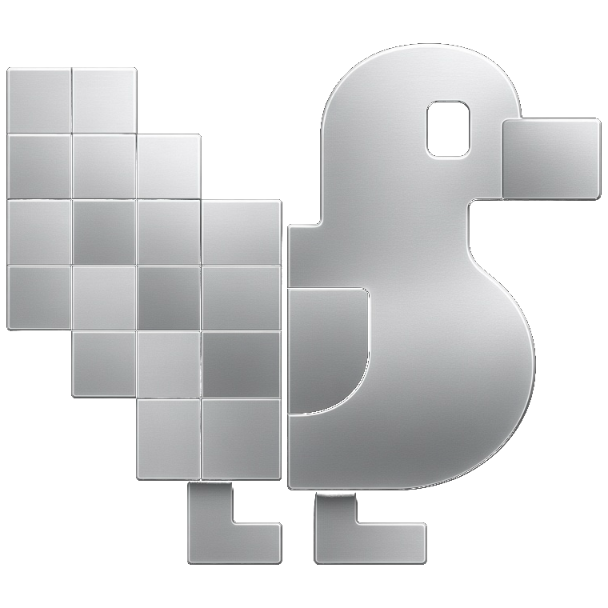
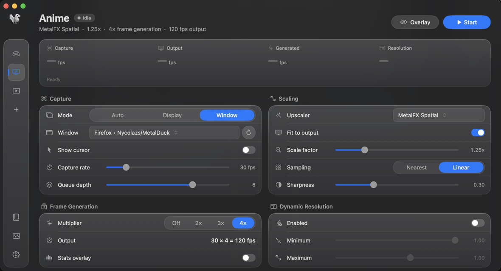
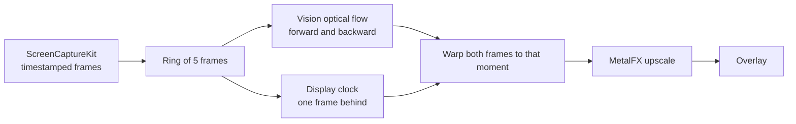

<p align="center">
  
</p>

<h1 align="center">MetalDuck</h1>

<p align="center">
  Upscaling and frame generation for any window or display on macOS.
</p>

<p align="center">
  
  
  
</p>

<p align="center">
  <a href="https://metalduck-production.up.railway.app">Website</a> ·
  <a href="https://github.com/Nycolazs/MetalDuck/releases/latest">Download</a>
</p>

MetalDuck captures a window or a display, builds the frames in between the ones it captured, and can scale the picture with MetalFX before showing it in its own overlay. It is aimed at games, video, and anime playing on an Apple silicon Mac.

The overlay follows the source and ignores mouse clicks, so you keep playing or watching in the original window. Frame generation needs the next real frame before it can draw the ones between, so the picture trails the source by roughly one captured frame.

<p align="center">
  
</p>

## What you can set

- **Capture.** A whole display or one window, with or without the cursor. Capture rate is the most frames MetalDuck keeps per second. Queue depth is how many the system may hold before they are used.
- **Frame generation.** Off, 2×, 3×, or 4×. The output rate is the capture rate times that multiplier, so 30 fps at 4× is 120 fps. It does not have a frame rate of its own.
- **Scaling.** MetalFX Spatial, or a plain resample. Scale factor, fit to the output, sampling, and sharpness.
- **Dynamic resolution.** Lowers the scale while frames are late and raises it when there is headroom.
- **Profiles.** Games, Anime, and Video are built in. The `+` button saves the current settings as your own profile.
- **Guide.** The book icon in the sidebar explains each control and opens the GitHub repository.
- **Monitor.** A page inside the main window with live capture, output, and generation numbers, charts, load, and the event log. Click Monitor in the sidebar, then click it again or press Esc to go back.

## Lossless Scaling (optional)

MetalDuck can keep your own copy of `Lossless.dll` from [Lossless Scaling](https://store.steampowered.com/app/993090/) on Steam. It is not bundled; you need the app in your Steam library.

1. Open **Settings** and click **Open** next to *Steam console*. This opens `steam://open/console` in the Steam client and copies the command below.
2. Paste and run it in the console:

   ```
   download_depot 993090 993091
   ```

3. When Steam prints the download folder, click **Import…** next to *Lossless.dll* and pick the file. MetalDuck copies it to `~/Library/Application Support/MetalDuck/Lossless.dll`.

## Using it

1. Open MetalDuck and allow Screen Recording when macOS asks. Without it the capture stays empty.
2. Pick a profile, or set the controls yourself. For a 24 fps video on a 120 Hz screen, the Anime profile is the starting point: capture capped at 30, generation at 4×.
3. Choose the window or display.
4. Press **Start**, or use the menu-bar icon. The first start asks you to choose the shortcut that stops scaling. Control-Option-Command-Escape always stops it.
5. The overlay appears over the source. **Stop** is on the button, in the menu bar, and on the shortcut.

The stats row shows capture fps, output fps, generated fps, and the resolution being drawn.

## How frame generation works

MetalDuck never receives motion vectors from the app it captures. It measures the motion between two real frames and draws the moments in between.



1. **Capture.** ScreenCaptureKit reports a frame whenever the window repaints, and each frame keeps the time of that repaint. Browsers repaint more often than the video changes (Firefox sent over 60 frames a second for a 24 fps trailer), so a frame showing the same picture as the last one is skipped. A copy left in would freeze the motion for one step and make the next step jump. The capture rate in the profile is applied on average to what remains, so a 24 fps video under a 30 fps cap keeps every frame. Forcing the cap inside ScreenCaptureKit would bunch 24 fps frames onto a 33 ms grid.

   Browsers also put video frames on screen a little early or late: Firefox showed a 24 fps video 27 to 69 ms apart. The motion in each frame still advances by one frame period, so while the timestamps fit a steady beat, frames are placed on that beat instead. Sources without a steady rate, such as most games, keep their own timestamps.

2. **Flow.** Every kept frame is copied into a ring of five and downscaled on the GPU to 800 pixels on the long side. Apple's Vision framework (`VNGenerateOpticalFlowRequest`, revision 1) estimates how the picture moved, in both directions, in pixels. The two directions run together and take about 20 ms for a pair on an M1 Pro. Up to two pairs are in flight. Each result is kept for the exact two frames it was computed from.

   Revision 1 is used on purpose. The newer revision is a little better on some fast objects, but it takes about 150 ms and reports motion as a fraction of a pixel. A live image cannot wait that long.

   Vision follows camera motion well but barely sees an object moving on its own across a still background: in tests a 120 px move came back as 4 px. So a block search runs next to it on the GPU, as each frame arrives. It searches up to about 320 px at 1/8 size, refines at 1/4 size to a fraction of a pixel, and drops matches that fail a round trip or disagree with their neighbours (repeated text matches one letter to another). Where a block moves clearly differently from Vision's flow, the generated frame takes, per pixel, the motion that lines up the two frames best, and each frame only where it can see the pixel. Elsewhere Vision's flow is used as before. The search costs about 4 ms of GPU per pair of frames.

   The same search tells when two frames have nothing in common. If the motion cannot match more than 35% of the detailed parts of the picture, the pair is a cut, a flash or a jump: in tests ordinary motion, fast objects included, left at most 25% unmatched, and cuts 40 to 100%. No frames are built between such a pair; the old picture stays until the new one's moment, as in the video. Where a single spot cannot be matched (an object faster than the search), that spot falls back to Vision's warp.

   Some pairs can be matched but not followed: fast action, anime drawn in big jumps, things that turn or change shape. In-between frames built for them show tears and see-through copies of what moves. So for each pair the GPU also tries, for every spot, each motion it knows at the midpoint between the frames, and measures how much of the picture none of them fits. In tests, real footage stayed at or under 0.07% (fast aerial moves included), fast objects over a pan reached 0.2 to 2.2%, and fast cel animation 1 to 2.9%. The **Artifact guard** setting in the Frame Generation panel acts on that number. **Balanced** (the default) starts drawing a pair's in-between frames toward the nearer real frame at 0.3% and shows only real frames from 1.5%. **Strong** does the same from 0.1% and 0.6%, and **Off** never does. The whole picture moves alike, so nothing tears or doubles, and those moments run closer to the video's own frame rate. Part of a calmed pair carries over to the next, so a scene near the limit does not switch with every frame.

3. **The moment on screen.** Frames are drawn on a thread of their own, paced by a `CAMetalDisplayLink`, which also says when each frame will reach the screen. The overlay runs about one capture interval behind the newest frame, plus the time the flow took, counted from that moment. By then the two frames around it have arrived, and their flow is usually ready. The delay only drifts, never jumps, so it does not look like a change in playback speed.

4. **The generated frame.** First, each pixel of both frames gets its motion: Vision's, or where blocks move on their own, the nearby block vector that lines it up clearly better. Then every pixel is carried to where it is at the moment being built, forward from the older frame and backward from the newer one. This is splatting. Where both frames land on a spot, both see it. Where only one lands, only that one does: background a person has just uncovered, or is about to cover. Where two layers land on one spot, each pixel counts by how well its own match holds, so a moving person wins over the background behind them. The frame is then drawn from those motions, each frame only where it sees the spot.

   Before splatting, the motion was read at the spot in the older frame. Just behind a walking person that spot belonged to the person, so the uncovered background was dragged along, and the edge being covered was handled the other way round. That made a halo and a see-through edge around anything large that moved, at any speed. On a test of a large walking figure with motion blur, splatting raised the figure area from 32.2–33.4 dB to 34.9–35.6 dB, and real footage improved in every test (46.9 to 47.1 dB on average). If the exact pair's flow is not ready yet, a result from at most two frames away can be used, and only where the two warped colours still agree.

5. **Scaling.** MetalFX runs after the frame is built, so the upscaler sees the frame you will actually watch.

A longer version, including the numbers from testing, is in [docs/FRAME_GENERATION.md](docs/FRAME_GENERATION.md).

### What this does not do

Desktop capture has no depth and no per-pixel motion from the game. Motion is estimated from the pictures alone. An object that moves more than about 320 pixels between two captures is missed. Where a fast object uncovers background, a thin strip at its edge can tear, because neither frame shows that background cleanly.

The picture is late by one captured frame, plus the flow (about 30 to 40 ms), plus about 41 ms that macOS takes to bring a frame to the screen. For a 24 fps video that is roughly 115 to 130 ms behind the sound. Waiting for the next frame is the reason the in-between frames can exist. Lossless Scaling on Windows works on the same idea.

## What the tests showed

Measured on an M1 Pro while building 1.3. A 24 fps source, the Anime profile, generation at 4×:

| | Before | 1.3 |
|---|---|---|
| Time between captured frames | 33, 33, 33, then 67 ms | 41–42 ms |
| Frames that reached the display | 112–116 per second | 118–120 per second |
| Average error of one step of motion | 2–3 ms | 0.4–1.2 ms |

The same 24 fps clip played in Safari under the overlay held 24 captured frames per second and about 118 frames on the display. Video keeps playing while the overlay is up. Some page animations do not, because the system pauses them when the window is covered.

Compared offline with a frame drawn at the true halfway point, a 40 pixel move scored 33.3 dB with this pipeline, 29.4 dB with the previous one, and 25.9 dB for a plain crossfade. Higher is closer to the real frame.

## Requirements

- Apple silicon Mac (M1 or later)
- macOS 15 or later
- Screen Recording permission

## Build and run

```bash
swift build
.build/debug/MetalDuck
```

A release disk image, with the version written into the app:

```bash
bash scripts/create_release.sh
```

That writes `dist/MetalDuck-1.3.2.dmg`. Open it and drag MetalDuck to Applications.

The current release is on [GitHub Releases](https://github.com/Nycolazs/MetalDuck/releases).

## Website

The landing page at [metalduck-production.up.railway.app](https://metalduck-production.up.railway.app) lives in [`site/`](site/), with instructions for running and deploying it.

## License

MIT. See [LICENSE](LICENSE).
