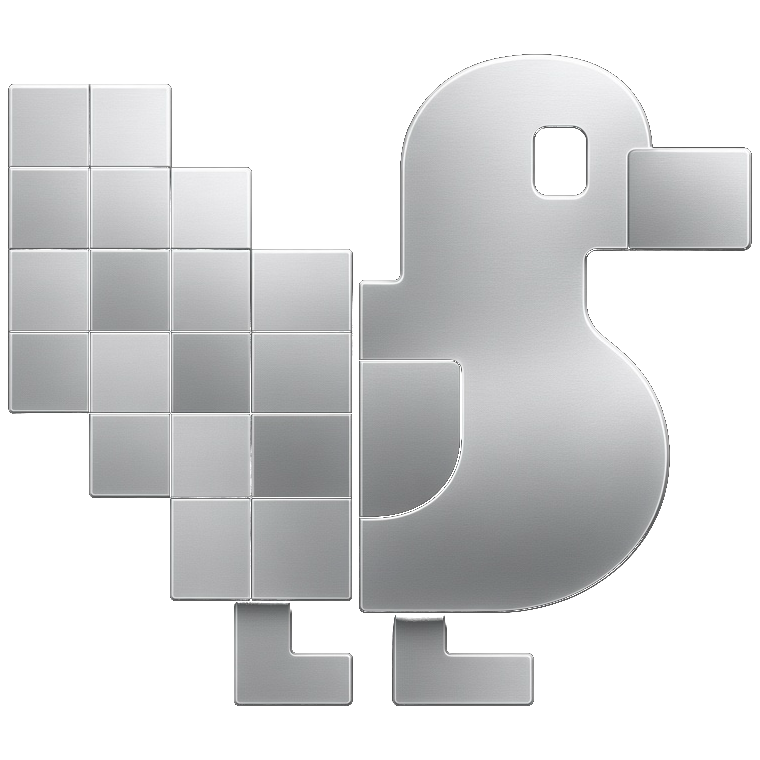
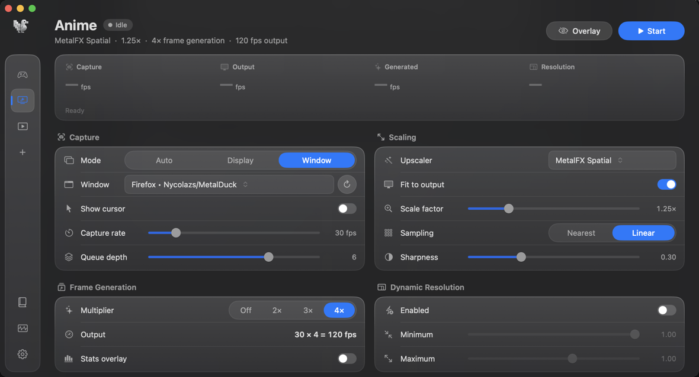
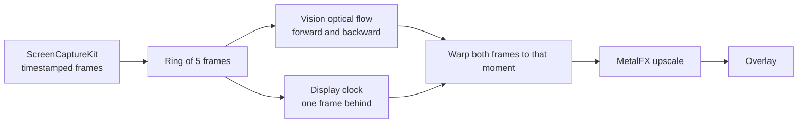

<p align="center">
  
</p>

<h1 align="center">MetalDuck</h1>

<p align="center">
  Upscaling and frame generation for any window or display on macOS.
</p>

<p align="center">
  
  
  
</p>

MetalDuck captures a window or a display, builds the frames in between the ones it captured, and can scale the picture with MetalFX before showing it in its own overlay. It is aimed at games, video, and anime playing on an Apple silicon Mac.

The overlay follows the source and ignores mouse clicks, so you keep playing or watching in the original window. Frame generation needs the next real frame before it can draw the ones between, so the picture trails the source by roughly one captured frame.

<p align="center">
  
</p>

## What you can set

- **Capture.** A whole display or one window, with or without the cursor. Capture rate is the most frames MetalDuck keeps per second. Queue depth is how many the system may hold before they are used.
- **Frame generation.** Off, 2×, 3×, or 4×. The output rate is the capture rate times that multiplier, so 30 fps at 4× is 120 fps. It does not have a frame rate of its own.
- **Scaling.** MetalFX Spatial, or a plain resample. Scale factor, fit to the output, sampling, and sharpness.
- **Dynamic resolution.** Lowers the scale while frames are late and raises it when there is headroom.
- **Profiles.** Games, Anime, and Video are built in. The `+` button saves the current settings as your own profile.
- **Guide.** The book icon in the sidebar explains each control and opens the GitHub repository.
- **Monitor.** Live capture, output, and generation numbers, plus whether frames are warped or blended.

## Using it

1. Open MetalDuck and allow Screen Recording when macOS asks. Without it the capture stays empty.
2. Pick a profile, or set the controls yourself. For a 24 fps video on a 120 Hz screen, the Anime profile is the starting point: capture capped at 30, generation at 4×.
3. Choose the window or display.
4. Press **Start**, or use the menu-bar icon. The first start asks you to choose the shortcut that stops scaling. Control-Option-Command-Escape always stops it.
5. The overlay appears over the source. **Stop** is on the button, in the menu bar, and on the shortcut.

The stats row shows capture fps, output fps, generated fps, and the resolution being drawn.

## How frame generation works

MetalDuck never receives motion vectors from the app it captures. It measures the motion between two real frames and draws the moments in between.



1. **Capture.** ScreenCaptureKit reports a frame whenever the content changes, and each frame keeps the time of that change. The capture rate in the profile is applied to those timestamps. Frames closer than the cap allows are dropped, but a 24 fps video under a 30 fps cap keeps its own even spacing. Forcing the cap inside ScreenCaptureKit would bunch 24 fps frames onto a 33 ms grid, and the motion would speed up and slow down.

2. **Flow.** Every kept frame is copied into a ring of five and downscaled on the GPU to 800 pixels on the long side. Apple's Vision framework (`VNGenerateOpticalFlowRequest`, revision 1) estimates how the picture moved, in both directions, in pixels. The two directions run together and take about 20 ms for a pair on an M1 Pro. Up to two pairs are in flight. Each result is kept for the exact two frames it was computed from.

   Revision 1 is used on purpose. The newer revision is a little better on some fast objects, but it takes about 150 ms and reports motion as a fraction of a pixel. A live image cannot wait that long.

3. **The moment on screen.** The overlay runs about one capture interval behind the newest frame, plus the time the flow took. By then the two frames around that moment have arrived, and their flow is usually ready. The delay only drifts when it is clearly wrong, so it does not look like a change in playback speed. The displayed time is also lined up with the display's own refresh.

4. **The generated frame.** One compute shader, `flowInterpolate`, moves the older frame forward and the newer frame backward to the same moment. A motion vector is trusted only when following it and then the opposite field comes back near the start. At the edge of a moving object, the side that can still see the pixel is the one that is drawn. Where neither side is trustworthy, the shader blends the two real frames instead of showing a broken warp. If the exact pair's flow is not ready yet, a result from at most two frames away can be used, and only where the two warped colours still agree.

5. **Scaling.** MetalFX runs after the frame is built, so the upscaler sees the frame you will actually watch.

A longer version, including the numbers from testing, is in [docs/FRAME_GENERATION.md](docs/FRAME_GENERATION.md).

### What this does not do

Desktop capture has no depth and no per-pixel motion from the game. A small object that moves more than about 45 pixels between two captures is often missed, and that spot falls back to a blend. Very fast pans can smear for the same reason.

The picture is late by about one captured frame plus roughly 25 ms. That delay is the reason the in-between frames exist. Lossless Scaling on Windows works on the same idea.

## What the tests showed

Measured on an M1 Pro while building 1.3. A 24 fps source, the Anime profile, generation at 4×:

| | Before | 1.3 |
|---|---|---|
| Time between captured frames | 33, 33, 33, then 67 ms | 41–42 ms |
| Frames that reached the display | 112–116 per second | 118–120 per second |
| Average error of one step of motion | 2–3 ms | 0.4–1.2 ms |

The same 24 fps clip played in Safari under the overlay held 24 captured frames per second and about 118 frames on the display. Video keeps playing while the overlay is up. Some page animations do not, because the system pauses them when the window is covered.

Compared offline with a frame drawn at the true halfway point, a 40 pixel move scored 33.3 dB with this pipeline, 29.4 dB with the previous one, and 25.9 dB for a plain crossfade. Higher is closer to the real frame.

## Requirements

- Apple silicon Mac (M1 or later)
- macOS 15 or later
- Screen Recording permission

## Build and run

```bash
swift build
.build/debug/MetalDuck
```

A release disk image, with the version written into the app:

```bash
bash scripts/create_release.sh
```

That writes `dist/MetalDuck-1.3.dmg`. Open it and drag MetalDuck to Applications.

The current release is on [GitHub Releases](https://github.com/Nycolazs/MetalDuck/releases).

## License

MIT. See [LICENSE](LICENSE).
